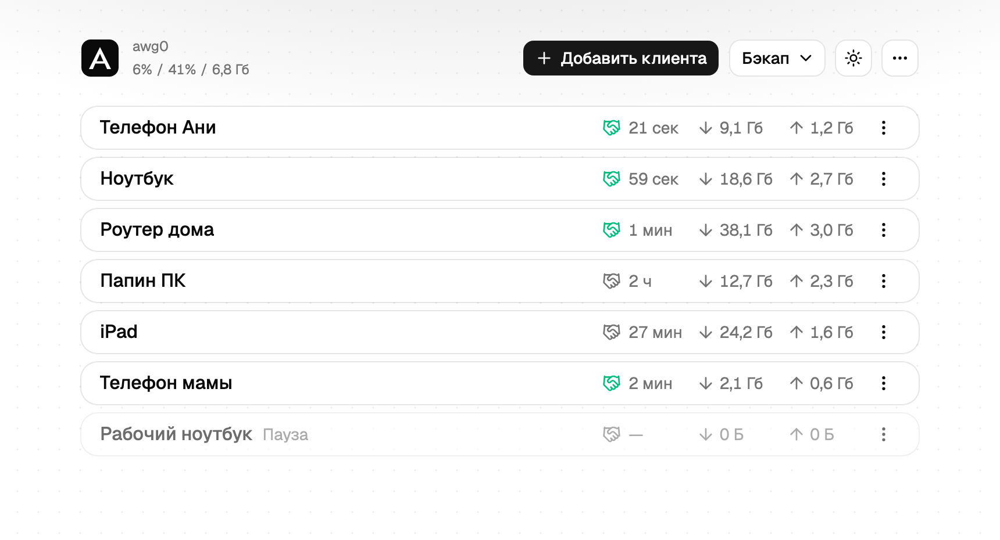
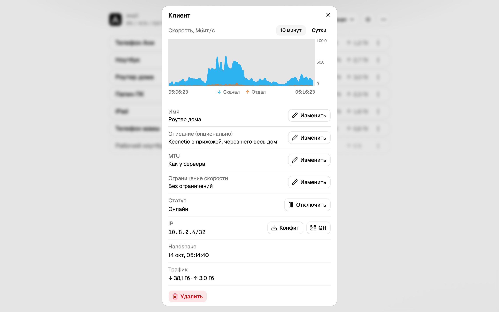
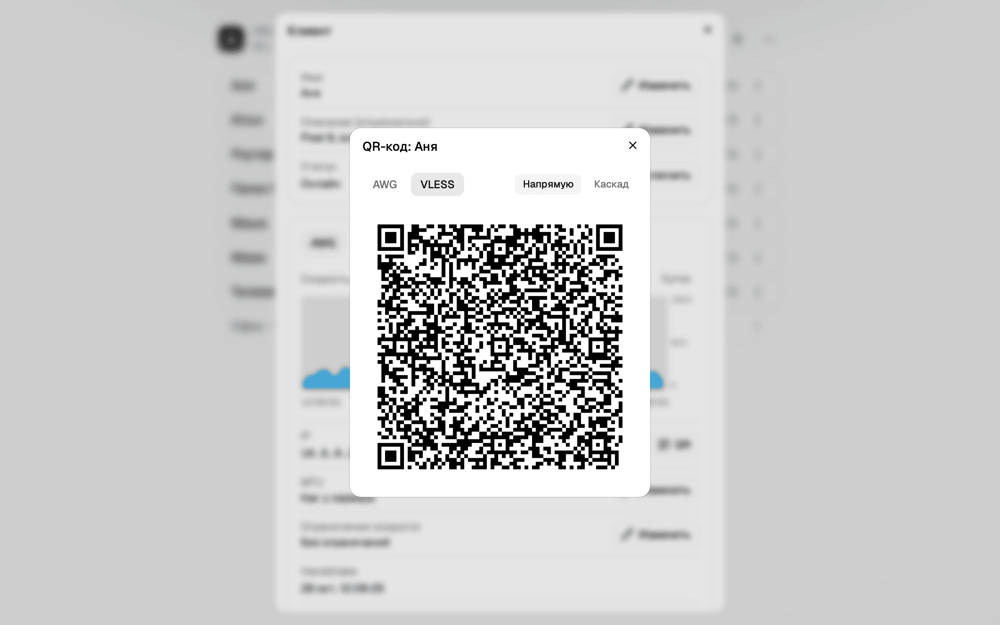
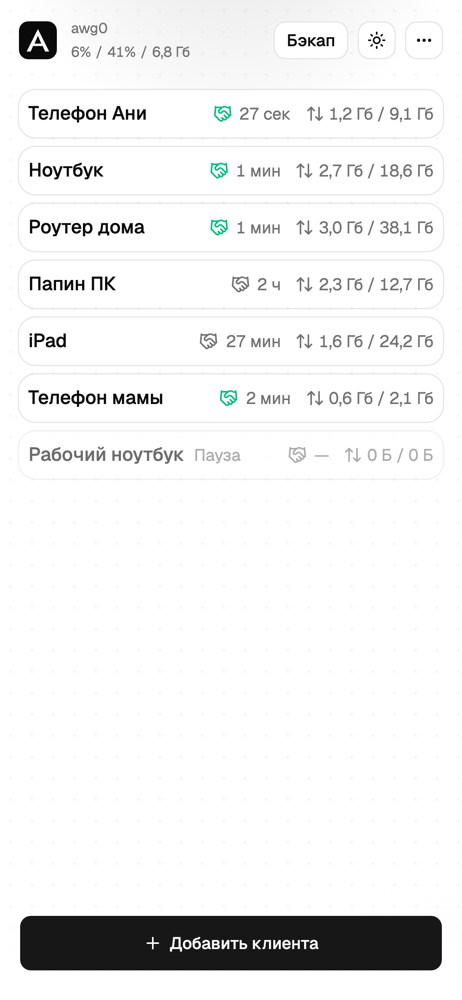

# AVL

**AmneziaWG + VLESS**

A script that sets up a VPN on your server, plus a web panel where you add clients with a button and connect them by QR code. One command from your computer, about five minutes.

The VPN runs on two protocols. A client can use either one or both.

AmneziaWG is WireGuard with packets that look different from plain WireGuard. VLESS is installed alongside it and is for networks where AmneziaWG does not connect, such as mobile networks: it runs over TCP 443.

Русская версия: [README.md](README.md) · Security: [SECURITY.md](SECURITY.md) · Development: [DEVELOPMENT.md](DEVELOPMENT.md)

## What you need

**A server** with root access over SSH:

| | Minimum | Notes |
| --- | --- | --- |
| System | Ubuntu 24.04 | the installer also accepts Ubuntu 22.04 and Debian 12 |
| CPU | 1 core | the install takes 3–5 minutes on one core |
| Memory | 1 GB, 2 GB is better | headroom as the client count grows |
| Disk | 10 GB | images and the database take under 1 GB |
| Ports | UDP 4500, TCP 443 or 8443 | plus TCP 80 for a Let's Encrypt certificate |

Such a server costs $3–5 a month. Watch the traffic allowance: a VPN uses as much as its clients do.

Everything is tested on Ubuntu 24.04. Debian 12 is not: AmneziaWG comes as a kernel module from `ppa:amnezia/ppa`, an Ubuntu repository, and the module may fail to rebuild after a kernel upgrade. Rocky, Alma, Fedora, Arch and Alpine are refused outright.

**A domain** is optional; without one everything works over the IP. There can be two, independent of each other:

- the panel domain (`--panel-domain`) gets a Let's Encrypt certificate instead of a self-signed one. Its A record must point at the server, and port 80 must be open
- the VPN domain (`--vpn-domain`) goes into client configs instead of the IP. If you move servers, repoint the record and everyone's settings keep working. The record must point at the server before the install; the installer checks it

**Your computer** is a Mac, a Linux machine or Windows. You need to be able to open a terminal and paste a command.

- Logging in with an SSH key needs nothing extra. Password login needs `sshpass` or `expect`. macOS already has `expect`; on Linux and in WSL install `sshpass`:

  ```sh
  sudo apt install sshpass
  ```

- On Windows the installer runs in neither PowerShell nor the command prompt: it is written for a Unix shell. Install WSL, which is Ubuntu inside Windows. In PowerShell as administrator:

  ```powershell
  wsl --install
  ```

  It installs Ubuntu and asks you to restart. After the restart Ubuntu opens by itself and asks for a username and password; they only exist inside it. Then open Ubuntu from the Start menu, install `sshpass` there and type every command from this guide there. WSL is available on Windows 11 and on Windows 10 version 2004 or later

## Install

```sh
curl -fsSL https://raw.githubusercontent.com/AndreyLear/avl/main/bootstrap.sh -o bootstrap.sh
bash bootstrap.sh
```

The wizard asks for the server address, the SSH user (`root` by default), a password or key, the panel domain, the panel port and the VPN domain. Enter accepts the value in brackets. You can pass the same answers as flags:

```sh
./bootstrap.sh --ip 203.0.113.10 --panel-domain panel.example.com --vpn-domain example.com
```

| Flag | What it sets |
| --- | --- |
| `--ip` | server address. With it the wizard asks nothing |
| `--user` | SSH user, `root` by default |
| `--key` | SSH key file, `~/.ssh/id_ed25519` by default, then `~/.ssh/id_rsa` |
| `--password-env VAR` | read the SSH password from the environment variable `VAR` |
| `--panel-domain` | panel domain with a Let's Encrypt certificate (alias `--domain`) |
| `--panel-port` | panel port: 443 with a domain, 8443 without |
| `--vpn-domain` | VPN domain for client configs (alias `--client-domain`) |
| `--awg-port` | tunnel UDP port, 4500 by default. Avoid 443 and 51820 |
| `--root` | install directory on the server, `/opt/amnezia-vpn` by default |
| `--source URL` | download a release tarball instead of packing the local repository |

The wizard prints steps `[1/9]` through `[9/9]`. Usually the images are downloaded ready-made. If step 7 says "Собираю образы" (building images), expect 10–30 minutes; the CPU sits at 100% and that is normal.

At the end it prints the panel address, the login, a temporary password, the client endpoint and the certificate fingerprint. Keep that: the password is not stored anywhere else.

```
Panel:     https://203.0.113.10:8443
Login:     admin
Password:  rZksiVMoEcPXsCQtFowec1+e
Endpoint:  example.com:4500
```

### First login

1. Open the panel at the address from the summary. Without a panel domain the browser warns about a self-signed certificate: compare the fingerprint with the one printed and continue
2. [Change the password](#changing-the-panel-password)
3. Press "Add client" (the panel interface is in Russian) and connect a device as described in [Clients](#clients)

### What the installer turns on

| What | What it does | How to turn it off |
| --- | --- | --- |
| SSH protection | `fail2ban`: five failed attempts in ten minutes, banned for an hour. It never touches the tunnel port: there are no passwords there, and a ban would cut off a real client | `--no-fail2ban` |
| IPv6 in the tunnel | on when the server has working IPv6. What is checked is that traffic actually leaves, not that an address exists: some hosts hand out an address that routes nowhere | `--no-ipv6` |
| Watchdog | once a minute it checks that the in-tunnel DNS answers and the tunnel writes its status. If VLESS is on, it also checks that Xray answers and accepts connections. After two failures in a row it restarts the service, at most once every ten minutes. A container can be running and useless, and Docker does not notice. It ignores client handshakes: people are legitimately offline | `--no-watchdog` |
| Update check | once a day the server asks GitHub whether a new release is out, and the panel shows the answer. It downloads and installs nothing | `--no-update-check` |
| In-tunnel DNS | the server answers the panel's hostname with an address inside the tunnel, so the panel opens with the VPN on and off | `--no-tunnel-dns` |

Any update check tells GitHub the address of your server. With `--no-update-check` it does not, but you have to follow releases yourself. With `--no-tunnel-dns` port 53 stays with the server's own DNS, and the panel no longer opens by name from devices connected to the VPN.

```sh
./bootstrap.sh --ip 203.0.113.10 --no-ipv6
```

`install.sh` takes the same flags if you run it on the server yourself. The choice is remembered on the server: a rerun without flags and an update from the panel turn nothing back on. To turn a service on again, pass the flag without `no-`: `--fail2ban`, `--watchdog`, `--update-check`, `--tunnel-dns`, `--ipv6`.

Turning IPv6 off removes it completely: the rules, the routing and the addresses in client configs. Updating never changes your choice: a server running without IPv6 stays without it. Switching IPv6 restarts the tunnel. Every client loses the connection for about 15 seconds and gets it back by itself, no configs to reissue.

## The panel

Everything is managed in the browser.

<p align="center"><br>Main screen: clients, protocols and server load</p>

<table>
  <tr>
    <td width="50%"></td>
    <td width="50%"></td>
  </tr>
  <tr>
    <td align="center">Client window: protocol tabs and speed chart</td>
    <td align="center">AWG and VLESS QR codes for the phone app</td>
  </tr>
</table>

<p align="center"><br>The same panel on a phone</p>

- **Header.** State of AWG and VLESS (red if a protocol is not working), then CPU, memory and disk load
- **Clients.** One card each: name, an icon for the protocol the client last connected over, when that was, how much it downloaded and uploaded. A disabled client is marked "Пауза" (Paused)
- **Client window.** Opens on the name: AWG and VLESS tabs, speed chart, IP address, config and QR code
- **"Бэкап" (Backup) button.** Download or upload the settings file
- **"Ещё" (More) menu.** Versions, service status, log, update check and "Уведомления" (Notifications), which sends failure alerts by email

## Clients

A client is one device: a phone, a laptop, a router. Each has its own keys, so disabling one leaves the others alone.

Press "Добавить клиента" (Add client) and type any name you will recognise. The panel assigns an address and creates keys. Then:

- **Phone.** Client menu → "QR-код", scan it in the app
- **Computer or router.** Client menu → "Скачать конфиг" (download config) and import the file into the app. The file is generated on download and stored nowhere

The same menu has "Сведения" (details: name, description, MTU, speed limit), "Отключить" (disable: the keys stay, the client cannot connect; the same item turns it back on) and "Удалить" (delete: keys are erased and the old config stops working for good).

Addresses come from `10.8.0.0/24`, so up to 253 clients.

## Apps

Any AmneziaWG client works.

**AmneziaWG** is the app for this protocol only:

- iOS — [App Store](https://apps.apple.com/app/amneziawg/id6478942365)
- Android — [Google Play](https://play.google.com/store/apps/details?id=org.amnezia.awg)
- Windows — [GitHub releases](https://github.com/amnezia-vpn/amneziawg-windows-client/releases). Take `amneziawg-amd64-<version>.msi`. There is `arm64` for ARM and `x86` for 32-bit Windows. Windows 7 and 8 need release 2.0.2 or older, which has files with `windows7` in the name

**AmneziaVPN** is Amnezia's general client with several protocols, for Windows, macOS, Linux, Android and iOS: [amnezia.org/downloads](https://amnezia.org/downloads). With a single server, AmneziaWG is enough

**Routers.** OpenWrt with the `amneziawg` package and Keenetic with AmneziaWG support are set up as an ordinary client, and then the whole home network goes through the VPN.

### When the tunnel runs on a router

Devices at home ask the router for names, not your server, and the client config never reaches them. So you need three steps:

1. **Make `10.8.0.1` the only DNS on the router.** Remove the rest, including the ones the provider hands out over DHCP
2. **Turn off DNS-over-HTTPS and DNS-over-TLS on the router.** Otherwise it keeps asking Cloudflare or Google over port 443, around the tunnel
3. **Turn off the provider's IPv6 on the internet connection.** If a device has an address from the provider, it picks that one and the traffic leaves around the VPN with your real address. On a Keenetic: IPv6 settings → IPv6 configuration → disabled

To check, run this on any device at home, not on the router itself:

```sh
curl -6 https://ifconfig.co
```

Your server's address or an error means all is well. The provider's address means part of the traffic goes around the tunnel.

**MTU.** A router on a wire carries larger packets than a phone on a mobile network, and the server default is sized for the phone. You can raise it for one client: "Сведения" → MTU → "Изменить", 1280–1440 allowed. That speeds up what the household sends out. The other direction is set by the server and shared by everyone

## Entry through an intermediate server

A second server, the entry node. It fits when connecting directly does not work: the client connects to the node over VLESS. Sites on its direct-exit list open straight from the node, from its address, without going through the main server. By default the list holds local sites of the country where the node stands. The node sends everything else to the main server. The link through the node appears in the client window in the panel. In the app it is called "VLESS Phone", and the direct link to the main server is "VLESS direct Phone". In the client window the route is labelled "Каскад" ("Cascade"), or "Каскад entry" if there are several nodes. The main server counts traffic through the entry per client, just like direct traffic.

**What you need**

- A main server installed with `--xray`, and a panel domain. The node fetches the client list from the panel over https, so without a panel domain it does not work
- A separate server: Debian 12, Ubuntu 22.04 or 24.04. Xray takes TCP port 443 on it
- For your own stub (the site a stranger sees): a domain pointing at this server and open TCP port 80, which issues the Let's Encrypt certificate

### How to install

1. **On the node.** Copy the repository or a release archive there and run in its directory:

   ```sh
   ./install.sh --role entry --panel https://panel.example.com --entry-domain entry.example.com
   ```

   At the end the installer prints a ready command to register the node in the panel: `panel xray entry set <name> --host … --sni … --public-key … --short-id … --path … --prefix "VLESS "`

2. **On the main server.** Run that command the way you run other panel commands:

   ```sh
   ssh root@203.0.113.10 "cd /opt/amnezia-vpn && docker compose --env-file versions.lock \
     run --rm -T panel-init /app/panel xray entry set entry --host entry.example.com --sni entry.example.com \
     --public-key … --short-id … --path … --prefix 'VLESS '"
   ```

   The command prints the node's secret once: the last word on the line with `token`, 43 characters. Copy it right away: the panel stores only a hash and cannot show it a second time.

3. **On the node.** Pass the secret to the installer:

   ```sh
   ./install.sh --role entry --entry-token -
   ```

   Paste the secret and press Enter. With `-` it stays out of the shell history.

From then on the node fetches the client list from the panel every minute. A new client can connect through the entry a minute after being added, and a disabled one is cut off there too.

### What the role installs

- Xray at a pinned version, the archive checked against its sha256
- Sync with the panel every minute
- Connection to the main server over IPv4 and IPv6: the request to the panel and the clients' traffic go over IPv4, and if it doesn't answer, over IPv6. This needs IPv6 on both servers and an AAAA record in DNS for the main server's name (and for the panel's name, if it differs); without it everything goes over IPv4 only. The «О версиях» (About) window in the panel shows which protocol the last request to the panel used
- Watchdog: once a minute it checks the node's Xray (its answer and its entry port) and restarts it after two failures in a row, at most once every 10 minutes. If only the main server is unreachable, it leaves Xray alone. The last restart is shown in the panel, in the «О версиях» (About) window
- Direct-exit site lists, updated weekly
- TCP settings for mobile networks (BBR)
- fail2ban for SSH. Not needed? Add `--no-fail2ban`

Docker and the panel are not needed on the node.

### If the node already has a site

You can show strangers your own site instead of the stub. Instead of `--entry-domain` pass:

```sh
./install.sh --role entry --panel https://panel.example.com \
  --entry-dest 127.0.0.1:4441 --entry-server-names site.example,www.site.example --entry-xver 1
```

The site must listen on 127.0.0.1 only, not on port 443. With `--entry-xver 1` it receives the visitor's address over PROXY protocol. In nginx that is `listen 127.0.0.1:4441 ssl proxy_protocol;`. Links point to the first name in the list.

### If something changes

- **The panel is down.** The node keeps working with the last list it received. Changes arrive once the connection is back
- **The secret leaked.** Issue a new one on the main server, and the old one stops working at once:

  ```sh
  ssh root@203.0.113.10 "cd /opt/amnezia-vpn && docker compose --env-file versions.lock \
    run --rm -T panel-init /app/panel xray entry token entry"
  ```

  Then run `./install.sh --role entry --entry-token -` on the node and paste the new secret
- **Renaming.** `panel xray entry rename <old> <new>` on the main server: the secret and the node's parameters stay, only the name changes
- **Rerun.** `./install.sh --role entry` with no flags changes no keys: the Reality keys, shortId and path are created once and kept in `/opt/xray-entry/settings.json`, so links already issued keep working
- **A node set up by hand.** If it is already in `/opt/xray-entry`, the installer takes it over in place, with the same keys. A settings file from elsewhere is brought in with `--import-settings FILE`

## Changing the panel password

The panel has no password form on purpose, so the password cannot be guessed through a browser. It is changed with a command on the server:

```sh
ssh root@203.0.113.10 "cd /opt/amnezia-vpn && docker compose --env-file versions.lock \
  run --rm -T panel-init /app/panel auth set-password admin --password-stdin"
```

The command prompts for nothing and just waits for input: type the new password and press Enter. It will be visible on screen. The old password is not needed.

## Backups

A backup is one file with everything you configured: the clients, their keys and the server's keys. You can restore it on the same server or a new one, and the configs you handed out keep working.

- **Download.** "Бэкап" → "Скачать". The file is named like `backup-2026-08-23.tar.zst` and is a few kilobytes
- **When.** After every change to the client list, and before reinstalling or changing hosts
- **Where to keep it.** With you, like a password: it contains the server's keys and is not encrypted. Do not send it by email or messenger. Do not keep the only copy on the server itself: if the server goes, so does the copy
- **Restore.** "Бэкап" → "Загрузить". Clients come back immediately, no restart. The panel password stays the current one. The mailbox password for notifications has to be entered again

## Moving to another server

1. While the old panel is up, download a backup
2. Install on the new server with the same wizard
3. In the new panel: "Бэкап" → "Загрузить"
4. The panel sees the backup came from another server and asks which address to give clients:
   - **The backup's address**, for people who connect by domain. Repoint the domain's A record at the new server and everyone reconnects by themselves
   - **This server's address**, for people who connected by IP. Hand them new configs from the panel

## Updating

From version 2.9.0 the panel shows that a new release is out and updates the server with a button. No SSH needed.

The first time is the old way: the update service ships with a release, so a server installed earlier has to be given it first. The same goes for anyone who turned the update check off (`--no-update-check`): without it the server does not know about new releases.

An update is the same wizard run again. It remembers the server's settings, so no flags are needed:

```sh
curl -fsSL https://raw.githubusercontent.com/AndreyLear/avl/main/bootstrap.sh -o bootstrap.sh
bash bootstrap.sh --ip 203.0.113.10
```

The VPN domain stays as it was even without `--vpn-domain`. To go back to the server address, say so: `--vpn-domain ""`. Client configs do not need reissuing. Connectivity drops for a few seconds and recovers by itself.

The wizard also updates what lives on the server itself: firewall rules, kernel settings, services. Anything new, like IPv6 in the tunnel, arrives only this way.

`docker compose pull` does not help: the image version comes from a file left by the previous install, so the same version that is running is downloaded again.

## Uninstalling

```sh
ssh root@203.0.113.10 "bash /opt/amnezia-vpn/cleanup.sh"
```

It prints what it would remove and changes nothing. Add `--yes` to go ahead. Only what the installer created is removed. The `fail2ban` package stays.

## If something is wrong

**Pages load but video does not.** Almost always MTU: small packets get through, large ones are dropped. The installer sets 1360, or less if the server's path is narrower (never below 1280). A reinstall usually fixes it. If not, lower the MTU in the client app, for example from 1360 to 1280.

**A client stopped connecting after a move.** Check where the domain points: `dig +short example.com`. It should be the new server's address.

**The panel does not open.** Check that the services are running:

```sh
ssh root@203.0.113.10 "docker ps"
```

`amnezia-vpn-panel-1` and `amnezia-vpn-awg-1` should be in the list.

## Security

This is built for one server and one administrator. Panel login is username and password only, no second factor. Five failed attempts in 15 minutes from one address lock that address out. A backup and SSH access are equivalent to access to the VPN, so protect them. More in [SECURITY.md](SECURITY.md).

## How it works

Four containers run on the server: the panel (which keeps its data in SQLite), AmneziaWG, DNS for connected clients and a one-shot init job. The panel listens on the server itself only; nginx serves it to the outside with a certificate. Everything else is rebuilt from the database, which is why a database backup restores both clients and server keys.

Client configs route IPv6 into the tunnel too, so it does not go around the VPN with your real address. If the tunnel carries no IPv6, those connections fail and apps fall back to IPv4.

The tunnel runs on UDP 4500. Port 443 is open almost everywhere, but it is the QUIC port, and on mobile networks it is slower. A tunnel on that port gave 20 Mbit/s against 45 on port 4500 and 40 with no tunnel at all. Port 4500 belongs to IPsec, which corporate VPNs use, and its speed does not drop.

The in-tunnel DNS exists because of the panel. It sits at the address where the tunnel ends. A packet sent to that address never enters the tunnel, and iOS creates no separate route outside the tunnel for it, so without answering the hostname differently the panel would be unreachable from exactly the devices connected to it. Clients get our DNS. If the tunnel carries IPv6, a public fallback is added after it: if ours stops, names keep resolving.

Without IPv6 there is no fallback: a public DNS would return IPv6 addresses the tunnel cannot carry, and you would get "pages open, video does not" with no visible cause. Here a failure is visible at once, and the watchdog brings DNS back within a minute.

Build and tests are in [DEVELOPMENT.md](DEVELOPMENT.md).

## License

MIT, see [LICENSE](LICENSE)
